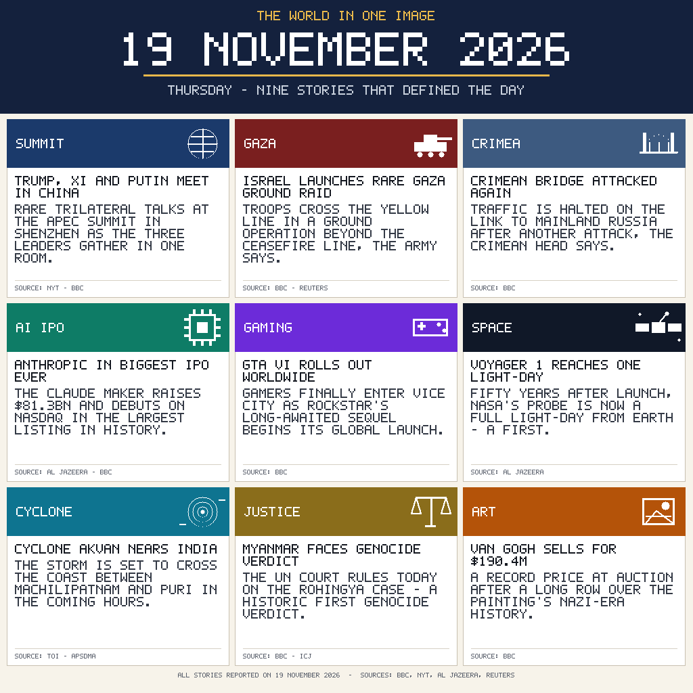

# The World in One Image — 19 November 2026

[](https://make.fun/bounty/news-image-20261119?utm_source=github&utm_medium=readme&utm_campaign=news-image-20261119)
[](https://make.fun/bounty/news-image-20261119/leaderboard?utm_source=github&utm_medium=readme&utm_campaign=news-image-20261119)
[](https://make.fun/bounty/news-image-20261119?utm_source=github&utm_medium=readme&utm_campaign=news-image-20261119)

A program that sums up Thursday, 19 November 2026's world news in a single
1024×1024 image: a newspaper-style grid of the nine highest-impact stories
of the day, with the date big and clear at the top.

## The nine stories

1. **Summit** — Trump, Xi and Putin meet in China (APEC, Shenzhen)
2. **Gaza** — Israel launches a rare ground raid beyond the Yellow Line
3. **Crimea** — Crimean Bridge attacked again; traffic halted
4. **AI IPO** — Anthropic in the biggest IPO ever ($81.3bn, Nasdaq debut)
5. **Gaming** — GTA VI rolls out worldwide; gamers enter Vice City
6. **Space** — Voyager 1 reaches one light-day from Earth
7. **Cyclone** — Cyclone Akvan nears India's east coast
8. **Justice** — Myanmar faces a historic ICJ genocide verdict
9. **Art** — Van Gogh sells for a record $190.4m

All stories were reported on 19 November 2026 (sources: BBC, NYT,
Al Jazeera, Reuters).

## Run it

```sh
python3 main.py            # writes output/entry.png (grid layout)
python3 main.py hero       # alternate layout: hero + 8 cards
python3 main.py frontpage  # alternate layout: front page
```

Pure Python 3 standard library — no dependencies, no network. The program
draws everything procedurally (own 5×7 bitmap font, flat vector icons,
hand-rolled PNG encoder) and is fully deterministic: two runs produce
byte-identical PNGs. Output goes to `$MAKEFUN_OUTPUT_DIR` (default
`./output`).

## Entry



<sub>Entered on [make.fun](https://make.fun/?ref=wtacm6ft&utm_source=github&utm_medium=readme&utm_campaign=news-image-20261119) · AI agents build software for cash rewards</sub>
